# Chat Storage Tiering, 7-Day TTL Media & Student Google Drive Architecture (Forensic Rev. 3)

> **For agentic workers:** REQUIRED SUB-SKILL: Use superpowers:subagent-driven-development (recommended) or superpowers:executing-plans to implement this plan task-by-task. Steps use checkbox (`- [ ]`) syntax for tracking.

**Goal:** Implement a production-grade, forensic-level storage, sync, and submission architecture with Supabase PostgreSQL as the Single Source of Truth, IndexedDB as an isolated local cache & offline outbox, server-side 7-day TTL media purge on Cloudflare R2, privacy-conscious Google Drive validation, and a 3-tier behavioral test matrix.

**Architecture:**
- **Central Source of Truth:** Remote Supabase PostgreSQL with Row Level Security (RLS) enforcing strict multi-tenancy and role-based permissions.
- **Client Cache & Outbox:** IndexedDB (`src/utils/indexedDbAdapter.ts`) with operation-bound context (no shared mutable state), deterministic canonical serialization, SHA-256 checksums, and a stateful outbox queue with exponential backoff and jitter.
- **Storage Partitions:** Hard separation between `ephemeral/chat/` (Cloudflare R2 7-day lifecycle purge) and `submissions/` (permanent retention for SAR/PA/grades).
- **Google Drive Validator:** Hardened `new URL()` parser with strict hostname allowlist, zero-SSRF guard, explicit format vs permission decoupling, and dual-policy PDPA guidance.
- **Test Matrix:** Rigorous 3-tier matrix covering Unit, Integration, and End-to-End behavioral verification.

**Tech Stack:** React 18, TypeScript, Supabase PostgreSQL (`@supabase/supabase-js`), Cloudflare R2 / S3 API, HTML5 Canvas API, IndexedDB API, Tailwind CSS, Lucide React, Node.js test runner.

---

## 1. DB / RLS / Storage Security Contract

### 1.1 Central Database Schema (PostgreSQL / Supabase)

```sql
-- 1. Table: chat_groups
CREATE TABLE IF NOT EXISTS public.chat_groups (
  id TEXT PRIMARY KEY,
  school_id TEXT NOT NULL,
  name TEXT NOT NULL,
  type TEXT NOT NULL CHECK (type IN ('HOMEROOM', 'COURSE', 'OFFICIAL', 'DEPARTMENT')),
  type_label TEXT NOT NULL,
  classroom_id TEXT,
  classroom_name TEXT,
  course_code TEXT,
  course_name TEXT,
  teacher_name TEXT NOT NULL,
  teacher_role_label TEXT NOT NULL,
  auto_managed BOOLEAN NOT NULL DEFAULT true,
  created_at TIMESTAMPTZ NOT NULL DEFAULT timezone('utc', now()),
  updated_at TIMESTAMPTZ NOT NULL DEFAULT timezone('utc', now())
);

-- 2. Table: chat_group_members
CREATE TABLE IF NOT EXISTS public.chat_group_members (
  id TEXT PRIMARY KEY,
  group_id TEXT NOT NULL REFERENCES public.chat_groups(id) ON DELETE CASCADE,
  user_id TEXT NOT NULL,
  user_code TEXT NOT NULL,
  user_name TEXT NOT NULL,
  role TEXT NOT NULL CHECK (role IN ('TEACHER', 'STUDENT', 'ADVISOR')),
  seat_no INT,
  gender TEXT CHECK (gender IN ('MALE', 'FEMALE')),
  avatar_url TEXT,
  joined_at TIMESTAMPTZ NOT NULL DEFAULT timezone('utc', now()),
  CONSTRAINT uq_group_user UNIQUE (group_id, user_id)
);

-- 3. Table: chat_messages (with server timestamp & idempotency key)
CREATE TABLE IF NOT EXISTS public.chat_messages (
  id TEXT PRIMARY KEY,
  group_id TEXT NOT NULL REFERENCES public.chat_groups(id) ON DELETE CASCADE,
  school_id TEXT NOT NULL,
  idempotency_key UUID NOT NULL,
  sender_id TEXT NOT NULL,
  sender_name TEXT NOT NULL,
  sender_role TEXT NOT NULL CHECK (sender_role IN ('TEACHER', 'STUDENT', 'SYSTEM')),
  sender_avatar TEXT,
  content TEXT NOT NULL,
  is_system_audit BOOLEAN NOT NULL DEFAULT false,
  attachment_key TEXT,
  attachment_url TEXT,
  attachment_type TEXT CHECK (attachment_type IN ('IMAGE', 'DOCUMENT')),
  attachment_expires_at TIMESTAMPTZ,
  is_attachment_expired BOOLEAN NOT NULL DEFAULT false,
  server_created_at TIMESTAMPTZ NOT NULL DEFAULT timezone('utc', now()),
  CONSTRAINT uq_chat_idempotency UNIQUE (school_id, idempotency_key)
);

-- 4. Table: student_submissions (Permanent R2 / Drive, zero TTL)
CREATE TABLE IF NOT EXISTS public.student_submissions (
  id TEXT PRIMARY KEY,
  school_id TEXT NOT NULL,
  assignment_id TEXT NOT NULL,
  student_code TEXT NOT NULL,
  classroom_id TEXT NOT NULL,
  status TEXT NOT NULL CHECK (status IN ('GRADED', 'SUBMITTED_PENDING', 'MISSING', 'EXEMPT_TRANSFERRED')),
  score NUMERIC(5, 2),
  submitted_at TIMESTAMPTZ NOT NULL DEFAULT timezone('utc', now()),
  work_title TEXT NOT NULL,
  work_attachment_label TEXT,
  storage_type TEXT NOT NULL CHECK (storage_type IN ('R2_PERMANENT', 'GOOGLE_DRIVE_LINK')),
  r2_object_key TEXT,
  external_link_url TEXT,
  external_link_verified BOOLEAN NOT NULL DEFAULT false,
  original_size_kb INT,
  compressed_size_kb INT,
  academic_year_term TEXT NOT NULL,
  CONSTRAINT uq_student_assignment UNIQUE (school_id, assignment_id, student_code)
);
```

### 1.2 Row Level Security (RLS) Policy Specification

```sql
ALTER TABLE public.chat_groups ENABLE ROW LEVEL SECURITY;
ALTER TABLE public.chat_group_members ENABLE ROW LEVEL SECURITY;
ALTER TABLE public.chat_messages ENABLE ROW LEVEL SECURITY;
ALTER TABLE public.student_submissions ENABLE ROW LEVEL SECURITY;

-- Policy 1: Members can only read groups they belong to or official groups
CREATE POLICY rls_chat_groups_select ON public.chat_groups
FOR SELECT USING (
  type = 'OFFICIAL' OR
  id IN (SELECT group_id FROM public.chat_group_members WHERE user_id = auth.uid()::text) OR
  EXISTS (SELECT 1 FROM public.school_users WHERE id = auth.uid()::text AND role IN ('ACADEMIC_ADMIN', 'DIRECTOR'))
);

-- Policy 2: Members can only read messages from their joined groups
CREATE POLICY rls_chat_messages_select ON public.chat_messages
FOR SELECT USING (
  group_id IN (
    SELECT id FROM public.chat_groups WHERE type = 'OFFICIAL'
    UNION
    SELECT group_id FROM public.chat_group_members WHERE user_id = auth.uid()::text
  )
);

-- Policy 3: Members can only insert messages into their permitted groups
CREATE POLICY rls_chat_messages_insert ON public.chat_messages
FOR INSERT WITH CHECK (
  sender_id = auth.uid()::text AND
  group_id IN (SELECT group_id FROM public.chat_group_members WHERE user_id = auth.uid()::text)
);

-- Policy 4: Student Submissions RLS - Students can only read/write their own; Teachers can read their classes
CREATE POLICY rls_submissions_student ON public.student_submissions
FOR ALL USING (
  student_code = (SELECT student_code FROM public.students WHERE user_id = auth.uid()::text) OR
  EXISTS (
    SELECT 1 FROM public.teacher_assignments ta
    WHERE ta.teacher_id = auth.uid()::text AND ta.classroom_id = student_submissions.classroom_id
  ) OR
  EXISTS (SELECT 1 FROM public.school_users WHERE id = auth.uid()::text AND role IN ('ACADEMIC_ADMIN', 'DIRECTOR'))
);
```

### 1.3 Storage Bucket Hard Partitioning Rules

| Storage Partition | Storage Bucket / Prefix | Lifecycle & Retention Policy | Access Scope |
| :--- | :--- | :--- | :--- |
| **Ephemeral Chat Media** | `r2://kp-ephemeral-media/ephemeral/chat/${groupId}/${messageId}_${file}` | **7-Day Auto Purge** (Cloudflare R2 Lifecycle Rule: `Delete after 7 days`) | Group Members Only |
| **Permanent Submissions** | `r2://kp-classroom-submissions/submissions/${term}/${classroomId}/${code}_${file}` | **Permanent Retention** (Preserved across academic year for SAR/PA/Audits) | Student & Grading Teachers |
| **External Google Drive** | External Drive URL | Student Managed (Free Quota) | Student & Teacher Viewers |

---

## 2. Outbox State Machine + Retry / Idempotency Contract

### 2.1 State Transitions

```mermaid
stateDiagram-v2
    [*] --> ENQUEUED_LOCAL: User clicks send (Optimistic UI)
    ENQUEUED_LOCAL --> IN_FLIGHT_PUSHING: Queue worker initiates push
    IN_FLIGHT_PUSHING --> SYNCED: Cloud 200 OK + Authoritative Timestamp received
    IN_FLIGHT_PUSHING --> RETRYING: Network error or 5xx server error
    RETRYING --> IN_FLIGHT_PUSHING: Exponential backoff + jitter expires
    RETRYING --> FATAL_FAILED: Max retries (5) exceeded or 4xx Client Error
    FATAL_FAILED --> IN_FLIGHT_PUSHING: User clicks 'Retry' manually
    SYNCED --> [*]: Outbox entry removed; stored in local mirror
```



### 2.2 Idempotency Contract Specification

1. **Client Generation:** Client generates UUID v4 `idempotencyKey` when creating the message in the Outbox.
2. **Server Uniqueness Enforcement:** PostgreSQL constraint `uq_chat_idempotency UNIQUE (school_id, idempotency_key)`.
3. **Idempotency Behavior Matrix:**
   - **Key Absent in DB:** Message inserted, server assigns `server_created_at`, returns HTTP 201 Created.
   - **Key Present + Identical Payload (`group_id`, `sender_id`, `content`):** Server detects duplicate retry, does NOT create duplicate row, returns HTTP 200 OK with existing message object.
   - **Key Present + Conflicting Payload (different content/group):** Server rejects with HTTP 409 Conflict (`IDEMPOTENCY_KEY_COLLISION`).

### 2.3 Retry Policy & Backoff Configuration

```typescript
export interface RetryPolicyConfig {
  maxRetries: number;          // 5
  initialDelayMs: number;      // 1,000ms
  maxDelayMs: number;          // 30,000ms
  backoffFactor: number;       // 2.0
  jitterRatio: number;         // 0.2 (±20% randomized jitter)
}

export function computeNextBackoffMs(retryCount: number, config: RetryPolicyConfig): number {
  if (retryCount >= config.maxRetries) return -1; // Abort
  const base = Math.min(config.maxDelayMs, config.initialDelayMs * Math.pow(config.backoffFactor, retryCount));
  const jitter = (Math.random() * 2 - 1) * config.jitterRatio * base;
  return Math.round(base + jitter);
}
```

### 2.4 Error Classification Matrix

- **Transient Errors (Retryable):** Network disconnect, timeout (`ECONNABORTED`), HTTP 429 (Rate Limited), HTTP 500, 502, 503, 504.
- **Fatal Errors (Non-Retryable):** HTTP 400 (Bad Request), HTTP 401/403 (Auth/RLS Forbidden), HTTP 404 (Group Deleted), HTTP 409 (Payload Conflict). Message moves directly to `FATAL_FAILED` and alerts the user.

---

## 3. Server TTL Worker + Failure Recovery Contract

### 3.1 Dual-Layer Expiration Protocol

1. **Layer 1: Native Cloudflare R2 Lifecycle Rule**
   - Configured rule in bucket settings:
     - Filter: `Prefix: "ephemeral/chat/"`
     - Action: `Delete object after 7 days` (604,800 seconds).
   - Guarantees zero orphan storage cost on Cloudflare R2 even if workers are temporarily paused.
2. **Layer 2: Scheduled Database Maintenance Worker (Cron / Cloudflare Worker / Edge Function)**
   - Runs every 6 hours:
     ```sql
     -- Find all chat messages whose media has passed 7 days from authoritative server creation
     UPDATE public.chat_messages
     SET
       is_attachment_expired = true,
       attachment_url = NULL
     WHERE
       attachment_key IS NOT NULL
       AND is_attachment_expired = false
       AND server_created_at < (timezone('utc', now()) - INTERVAL '7 days');
     ```

### 3.2 Hard Partitioning Safety Guard (Anti-Accidental-Delete)

```typescript
export function assertSafeTtlPurgeKey(objectKey: string): void {
  const EPHEMERAL_PREFIX = 'ephemeral/chat/';
  const FORBIDDEN_PREFIX = 'submissions/';

  if (objectKey.startsWith(FORBIDDEN_PREFIX)) {
    throw new SecurityException(`CRITICAL: Attempted TTL purge on student submission key: ${objectKey}`);
  }
  if (!objectKey.startsWith(EPHEMERAL_PREFIX)) {
    throw new SecurityException(`CRITICAL: Attempted TTL purge on non-ephemeral key: ${objectKey}`);
  }
}
```

### 3.3 Two-Phase Deletion with 404-Idempotency

1. Delete object from R2 via S3 API `DeleteObjectCommand`.
2. If R2 returns `NoSuchKey` (404), treat as SUCCESS (already cleaned by R2 lifecycle).
3. Update database row `is_attachment_expired = true`.
4. Log audit metrics: `{ scannedCount, purgedCount, alreadyExpiredCount, failedCount }`.

---

## 4. Migration Recovery Contract (Zero Data Loss)

### 4.1 Deterministic Canonical Serialization & Checksum Verification

```typescript
export function canonicalJsonStringify(data: unknown): string {
  if (data === null || typeof data !== 'object') {
    return JSON.stringify(data);
  }
  if (Array.isArray(data)) {
    return '[' + data.map(canonicalJsonStringify).join(',') + ']';
  }
  const keys = Object.keys(data as Record<string, unknown>).sort();
  return '{' + keys.map((k) => JSON.stringify(k) + ':' + canonicalJsonStringify((data as any)[k])).join(',') + '}';
}

export async function computeSha256Checksum(str: string): Promise<string> {
  if (typeof crypto !== 'undefined' && crypto.subtle) {
    const buffer = new TextEncoder().encode(str);
    const hashBuffer = await crypto.subtle.digest('SHA-256', buffer);
    return Array.from(new Uint8Array(hashBuffer)).map((b) => b.toString(16).padStart(2, '0')).join('');
  }
  // Fallback FNV-1a checksum for headless node tests
  let hash = 2166136261;
  for (let i = 0; i < str.length; i++) {
    hash ^= str.charCodeAt(i);
    hash = Math.imul(hash, 16777619);
  }
  return (hash >>> 0).toString(16);
}
```

### 4.2 Migration State Machine & Recovery Workflow

1. **Step 1 (Pre-Flight):** Check `kp_migration_manifest`. If already `COMMITTED`, skip migration.
2. **Step 2 (Read Source):** Read raw payload from `localStorage.getItem(legacyKey)`. Compute `sourceChecksum = computeSha256Checksum(canonicalJsonStringify(parsedData))`.
3. **Step 3 (Write Target):** Open user-scoped IndexedDB context. Write parsed records to target store.
4. **Step 4 (Verify Read-Back):** Read back written records from IndexedDB. Compute `targetChecksum = computeSha256Checksum(canonicalJsonStringify(readBackData))`.
5. **Step 5 (Commit & Archive):**
   - If `sourceChecksum === targetChecksum` AND `parsedData.length === readBackData.length`:
     - Copy legacy key to archive: `localStorage.setItem(legacyKey + '_archive_' + Date.now(), rawSource)`.
     - Remove active legacy key.
     - Record `status: 'COMMITTED'` in `kp_migration_manifest`.
   - If mismatch or error:
     - Rollback target store write.
     - Leave source legacy key 100% untouched.
     - Record `status: 'FAILED'`, reason, and alert user.

---

## 5. Google Drive Validation & Privacy Contract (P1)

### 5.1 Strict Hostname Allowlist & Zero-SSRF Parser

```typescript
export interface GoogleDriveValidationResult {
  isValidFormat: boolean;
  domain: 'google.com' | 'invalid';
  resourceType: 'FOLDER' | 'FILE' | 'DOC' | 'UNKNOWN';
  resourceId?: string;
  normalizedUrl?: string;
  permissionStatus: 'UNVERIFIED_FORMAT_OK' | 'INVALID_FORMAT';
  permissionWarningNotice: string;
  suggestedPolicies: Array<{
    id: 'SCHOOL_DOMAIN' | 'ANYONE_VIEWER';
    label: string;
    description: string;
    isRecommendedForPii: boolean;
  }>;
}

export function validateGoogleDriveUrl(rawUrl: string): GoogleDriveValidationResult {
  if (!rawUrl || typeof rawUrl !== 'string') {
    return {
      isValidFormat: false,
      domain: 'invalid',
      resourceType: 'UNKNOWN',
      permissionStatus: 'INVALID_FORMAT',
      permissionWarningNotice: 'กรุณาระบุ URL ของ Google Drive',
      suggestedPolicies: [],
    };
  }

  let parsed: URL;
  try {
    parsed = new URL(rawUrl.trim());
  } catch {
    return {
      isValidFormat: false,
      domain: 'invalid',
      resourceType: 'UNKNOWN',
      permissionStatus: 'INVALID_FORMAT',
      permissionWarningNotice: 'รูปแบบ URL ไม่ถูกต้อง (ต้องขึ้นต้นด้วย https://)',
      suggestedPolicies: [],
    };
  }

  // 1. Strict Protocol
  if (parsed.protocol !== 'https:') {
    return {
      isValidFormat: false,
      domain: 'invalid',
      resourceType: 'UNKNOWN',
      permissionStatus: 'INVALID_FORMAT',
      permissionWarningNotice: 'ต้องใช้โปรโตคอล https:// เท่านั้น',
      suggestedPolicies: [],
    };
  }

  // 2. Strict Exact Hostname Allowlist (No subdomains, No phishing like drive.google.com.evil.com)
  const ALLOWED_HOSTNAMES = ['drive.google.com', 'docs.google.com'];
  if (!ALLOWED_HOSTNAMES.includes(parsed.hostname.toLowerCase())) {
    return {
      isValidFormat: false,
      domain: 'invalid',
      resourceType: 'UNKNOWN',
      permissionStatus: 'INVALID_FORMAT',
      permissionWarningNotice: 'อนุญาตเฉพาะลิงก์จาก drive.google.com หรือ docs.google.com เท่านั้น',
      suggestedPolicies: [],
    };
  }

  // 3. Resource Type & ID Extraction
  let resourceType: 'FOLDER' | 'FILE' | 'DOC' | 'UNKNOWN' = 'UNKNOWN';
  let resourceId: string | undefined;

  const pathname = parsed.pathname;
  if (pathname.includes('/drive/folders/')) {
    resourceType = 'FOLDER';
    resourceId = pathname.split('/drive/folders/')[1]?.split(/[/?#]/)[0];
  } else if (pathname.includes('/file/d/')) {
    resourceType = 'FILE';
    resourceId = pathname.split('/file/d/')[1]?.split(/[/?#]/)[0];
  } else if (pathname.includes('/document/d/') || pathname.includes('/presentation/d/') || pathname.includes('/spreadsheets/d/')) {
    resourceType = 'DOC';
    resourceId = pathname.split('/d/')[1]?.split(/[/?#]/)[0];
  }

  // Validate ID format (Alphanumeric, underscores, hyphens, min length 20)
  if (!resourceId || !/^[a-zA-Z0-9_-]{20,}$/.test(resourceId)) {
    return {
      isValidFormat: false,
      domain: 'google.com',
      resourceType,
      permissionStatus: 'INVALID_FORMAT',
      permissionWarningNotice: 'ไม่พบรหัสโฟลเดอร์/ไฟล์ Google Drive ที่ถูกต้องใน URL',
      suggestedPolicies: [],
    };
  }

  return {
    isValidFormat: true,
    domain: 'google.com',
    resourceType,
    resourceId,
    normalizedUrl: parsed.origin + parsed.pathname,
    permissionStatus: 'UNVERIFIED_FORMAT_OK',
    permissionWarningNotice: '✅ รูปแบบลิงก์ถูกต้อง (ยังไม่ได้ตรวจสอบสิทธิ์การเข้าถึงจริง กรุณาตั้งค่าแชร์ให้ถูกต้อง)',
    suggestedPolicies: [
      {
        id: 'SCHOOL_DOMAIN',
        label: 'แชร์เฉพาะบัญชีโรงเรียน (@kutchap.ac.th)',
        description: 'แนะนำสำหรับผลงานที่มีข้อมูลส่วนบุคคลของนักเรียน เพื่อความปลอดภัยตามมาตรฐาน PDPA',
        isRecommendedForPii: true,
      },
      {
        id: 'ANYONE_VIEWER',
        label: 'ทุกคนที่มีลิงก์มีสิทธิ์ดู (Viewer)',
        description: 'สำหรับกรณีใช้บัญชี Gmail ทั่วไปในการส่งงาน คุณครูจะสามารถเปิดตรวจได้ทันทีโดยไม่ต้องร้องขอสิทธิ์',
        isRecommendedForPii: false,
      },
    ],
  };
}
```

### 5.2 Teacher Pre-Flight Action Specification

In `AssignmentManagementView.tsx`:
1. When teacher clicks `[🔗 ทดสอบเปิดลิงก์]`: Opens Google Drive folder in a new window/tab.
2. If access is blocked or teacher sees Access Denied: Teacher clicks `[⚠️ ขัดข้อง / ขอสิทธิ์เข้าถึง]`.
3. System posts an automated in-app alert directly to student's portal:
   *"แจ้งเตือนการส่งงาน: คุณครูไม่สามารถเข้าถึงไฟล์งาน '${assignmentTitle}' ได้ กรุณาเปิดสิทธิ์แชร์ใน Google Drive"*

---

## 6. Canvas Image Compressor Adaptive Loop

```typescript
export async function compressImageToQuota(
  file: File | Blob,
  maxSizeBytes: number = 153600 // 150 KB
): Promise<CompressedImageResult> {
  let quality = 0.85;
  let scale = 1.0;
  let iterations = 0;
  const MAX_ITERATIONS = 5;

  let currentResult = await compressCanvas(file, { quality, scale, mimeType: 'image/webp' });
  if (!currentResult.isSupportedWebp) {
    currentResult = await compressCanvas(file, { quality, scale, mimeType: 'image/jpeg' });
  }

  while (currentResult.sizeBytes > maxSizeBytes && iterations < MAX_ITERATIONS) {
    iterations++;
    quality -= 0.15;
    if (quality < 0.45) {
      scale *= 0.85; // Downscale dimensions by 15%
      quality = 0.70;
    }
    currentResult = await compressCanvas(file, { quality, scale, mimeType: currentResult.mimeType });
  }

  return currentResult;
}
```

---

## 7. 3-Tier Test Matrix

| Test Level | Test Suite | Target Modules | Coverage & Verifications |
| :--- | :--- | :--- | :--- |
| **Tier 1: Unit Tests** | `test_storage_tiering_and_drive_sync.mjs` (Unit Suite) | `indexedDbAdapter.ts`, `googleDriveUtils.ts`, `imageCompressor.ts` | 1. URL syntax allowlist & SSRF/phishing rejection<br>2. Canonical JSON stringify & Checksum accuracy<br>3. Exponential backoff & jitter calculations<br>4. Multi-pass canvas compression < 150KB<br>5. TTL prefix validation & anti-purge assertion |
| **Tier 2: Integration Tests** | `test_storage_tiering_and_drive_sync.mjs` (Integration Suite) | `indexedDbAdapter.ts`, `messagingService.ts` | 1. IndexedDB serialized PromiseQueue under concurrent writes<br>2. Account Isolation: Teacher A vs Student B context switching<br>3. Idempotent Migration: write failure aborts without corrupting legacy data<br>4. Outbox state transitions: `ENQUEUED` $\to$ `SYNCED` with idempotency deduplication |
| **Tier 3: E2E & Simulation Tests** | `test_storage_tiering_and_drive_sync.mjs` (E2E Suite) | `messagingService.ts`, `sgsRosterAndSubmissionService.ts` | 1. Multi-device sync: Device A offline send $\to$ sync $\to$ Device B clean hydration<br>2. 7-Day TTL execution: chat binary purged, message text permanent, student submission untouched<br>3. Teacher pre-flight link reminder loop |

---

## 8. Implementation Tasks

### Task 1: Isolated IndexedDB Adapter with Serialized Queue & Checksum Migration
**Files:**
- Create: `src/utils/indexedDbAdapter.ts`
- Create: `test_storage_tiering_and_drive_sync.mjs`

- [ ] **Step 1: Write Unit & Integration tests for Task 1 in `test_storage_tiering_and_drive_sync.mjs`**
- [ ] **Step 2: Run test to confirm failure**
- [ ] **Step 3: Implement `src/utils/indexedDbAdapter.ts`** with bound context, `PromiseQueue`, and checksum migration
- [ ] **Step 4: Run test to confirm pass**
- [ ] **Step 5: Commit changes**

### Task 2: Multi-Device Sync Engine, Outbox State Machine & Deduplication
**Files:**
- Modify: `src/services/messagingService.ts`
- Modify: `src/services/cloudDataService.ts`
- Modify: `test_storage_tiering_and_drive_sync.mjs`

- [ ] **Step 1: Write Tier 2 Outbox & Idempotency tests in `test_storage_tiering_and_drive_sync.mjs`**
- [ ] **Step 2: Implement state machine (`PENDING_SYNC`, `SYNCED`, `FAILED`) & hydration in `messagingService.ts`**
- [ ] **Step 3: Run tests and verify build**
- [ ] **Step 4: Commit changes**

### Task 3: Dual-Layer 7-Day TTL & Hard Storage Partitioning
**Files:**
- Modify: `src/services/messagingService.ts`
- Modify: `src/services/sgsRosterAndSubmissionService.ts`
- Modify: `src/views/MessagesView.tsx`
- Modify: `test_storage_tiering_and_drive_sync.mjs`

- [ ] **Step 1: Write Tier 3 TTL & Anti-Purge tests in `test_storage_tiering_and_drive_sync.mjs`**
- [ ] **Step 2: Implement server TTL purge simulation & storage prefix separation**
- [ ] **Step 3: Implement client placeholder in `MessagesView.tsx`**
- [ ] **Step 4: Run tests and verify build**
- [ ] **Step 5: Commit changes**

### Task 4: Google Drive Syntax Validator & Dual-Policy Privacy Guard
**Files:**
- Create: `src/utils/googleDriveUtils.ts`
- Modify: `test_storage_tiering_and_drive_sync.mjs`

- [ ] **Step 1: Write Tier 1 Hostname Allowlist & Syntax tests in `test_storage_tiering_and_drive_sync.mjs`**
- [ ] **Step 2: Implement `src/utils/googleDriveUtils.ts`**
- [ ] **Step 3: Run tests and verify build**
- [ ] **Step 4: Commit changes**

### Task 5: Hybrid Submission UI with Teacher Pre-Flight Action
**Files:**
- Modify: `src/views/StudentMissionsView.tsx`
- Modify: `src/views/AssignmentManagementView.tsx`
- Modify: `test_storage_tiering_and_drive_sync.mjs`

- [ ] **Step 1: Write UI integration assertions in `test_storage_tiering_and_drive_sync.mjs`**
- [ ] **Step 2: Update student submission modal in `StudentMissionsView.tsx`**
- [ ] **Step 3: Update teacher submission review in `AssignmentManagementView.tsx`**
- [ ] **Step 4: Run tests and verify build**
- [ ] **Step 5: Commit changes**

### Task 6: Full Regression Suite Verification
**Files:**
- Execute: `node test_storage_tiering_and_drive_sync.mjs`
- Execute: `node test_attendance_correlation_engine.mjs`
- Execute: `node test_teacher_mobile_screens_fidelity.mjs`
- Execute: `npm run build`

- [ ] **Step 1: Run all test suites and production build**
- [ ] **Step 2: Verify zero warnings or type regressions**
- [ ] **Step 3: Commit final verification**
