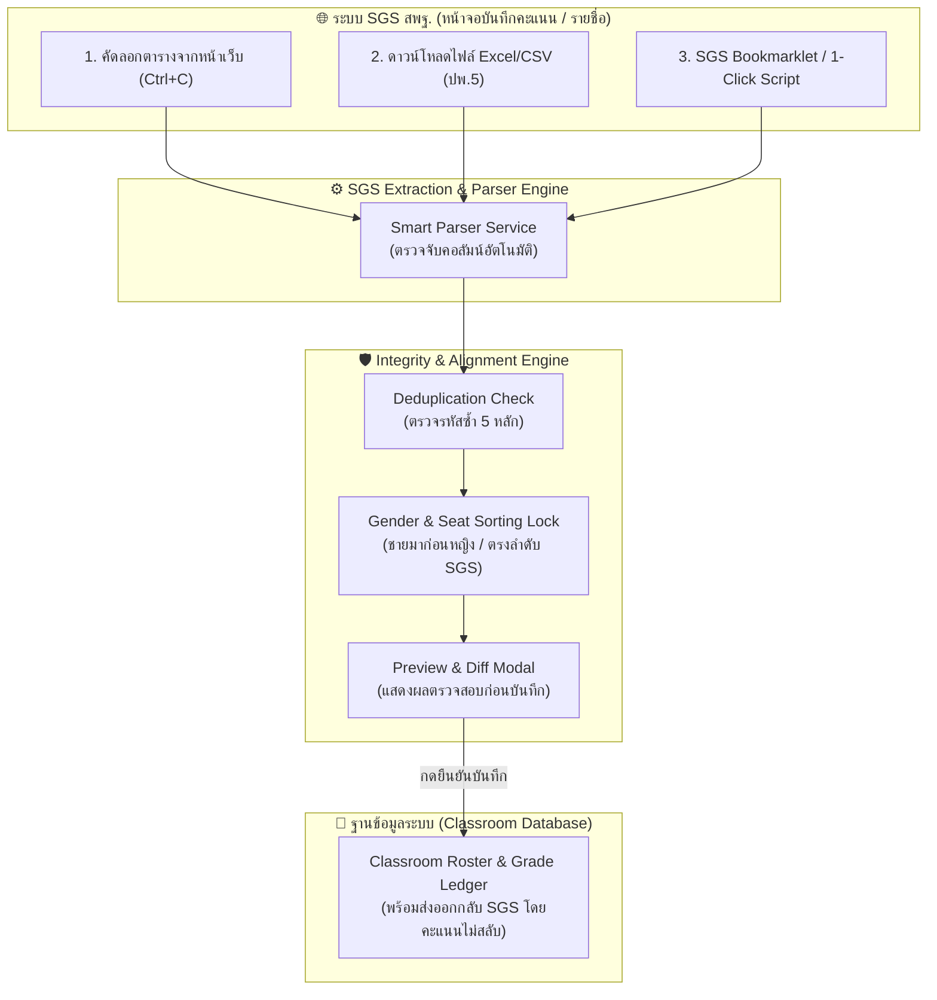

# แผนการออกแบบฟังก์ชันดึงและนำเข้ารายชื่อนักเรียนจากระบบ SGS สพฐ.
# (SGS Roster Extraction, Deduplication & Alignment System)

> **สำหรับระบบ:** KP Classroom Management (Pastel Anime Education Dashboard)  
> **เป้าหมายหลัก:** ดึงข้อมูล รหัสนักเรียน, ชื่อ-นามสกุล, ชั้น/ห้อง, เลขที่ จากระบบ SGS โดยไม่เพิ่มข้อมูลซ้ำ และคงลำดับแถวให้ตรงกับ SGS 100% เพื่อป้องกันปัญหาคะแนนสลับคนเวลาส่งออกคะแนน

---

## 1. การวิเคราะห์ที่มาและข้อจำกัดของระบบ SGS (สพฐ.)

### 1.1 ทำไมจึงไม่สามารถยิง Direct API ข้าม Server ได้โดยตรง?
1. **ระบบ SGS (Secondary Grading System - sgs.bopp-obec.info)** เป็นเว็บแอปพลิเคชันภายในของ สพฐ. ที่**ไม่มี Public REST API หรือ Webhook** สำหรับบุคคลภายนอก
2. ระบบมีระบบรักษาความปลอดภัย Session Authentication, Captcha และจำกัดสิทธิ์การเข้าถึงตาม IP/เบราว์เซอร์ของครูผู้สอน
3. หากใช้วิธี Web Scraping แบบยิง HTTP Request หลังบ้าน จะติดปัญหา Session หมดอายุ และเสี่ยงต่อการผิดนโยบายความปลอดภัยของ สพฐ.

### 1.2 แนวทางการดึงข้อมูลที่มีประสิทธิภาพและปลอดภัยที่สุด 3 ช่องทาง



| วิธีการดึงข้อมูล | ความสะดวกของครู | ความเสี่ยง / ข้อจำกัด | สถานะการพัฒนา |
|---|---|---|---|
| **วิธีที่ 1: Smart Copy-Paste (แนะนำสูงสุด)** | ⭐⭐⭐⭐⭐ ง่ายที่สุด ครูแค่กดคลุมตารางใน SGS แล้วกด Ctrl+V วาง | ไม่มีข้อจำกัดเรื่องเวอร์ชันไฟล์ Excel | **ฟังก์ชันหลัก (Core)** |
| **วิธีที่ 2: อัปโหลดไฟล์ Excel / CSV จาก SGS** | ⭐⭐⭐⭐ ดีมาก รองรับไฟล์ส่งออกจาก SGS ทันที | ไฟล์ SGS บางเวอร์ชันเป็น HTML ปลอมเป็น .xls หรือ .csv | **ฟังก์ชันหลัก (Core)** |
| **วิธีที่ 3: SGS Bookmarklet (ตัวเสริม)** | ⭐⭐⭐⭐⭐ คลิกปุ่มเดียวบนบุ๊กมาร์กบราวเซอร์ ดูดรายชื่อส่งตรงเข้าระบบ | ครูต้องลากปุ่ม Bookmarklet ไปวางบนแถบบุ๊กมาร์กครั้งแรก | **ฟังก์ชันเสริม (Add-on)** |

---

## 2. โครงสร้างข้อมูลที่ต้องดึง (Data Model)

ข้อมูลที่ต้องสกัดออกมาจาก SGS ประกอบด้วย 5 ฟิลด์หลัก:

```typescript
export interface ExtractedSgsStudent {
  sgsSeatNo: number;          // เลขที่ตาม SGS (สำคัญมาก ลำดับ 1, 2, 3...)
  studentCode: string;        // รหัสประจำตัวนักเรียน 5 หลัก (เช่น '45101') - Primary Unique Key
  title: string;              // คำนำหน้า (ด.ช., ด.ญ., นาย, นางสาว)
  firstName: string;          // ชื่อ
  lastName: string;           // นามสกุล
  fullName: string;           // ชื่อ-สกุลเต็ม (เช่น 'ด.ช. ณัฐวุฒิ สุทธิรักษ์')
  gender: 'MALE' | 'FEMALE';  // เพศ (แยกตามคำนำหน้า เพื่อใช้ล็อกลำดับตามกฎ สพฐ.)
  classroom: string;          // ชั้น/ห้อง (เช่น 'ม.3/1', '3/1')
  nationalId?: string;        // เลขประจำตัวประชาชน 13 หลัก (ถ้ามี)
  status: 'ACTIVE' | 'TRANSFERRED_IN' | 'TRANSFERRED_OUT';
}
```

---

## 3. ระบบป้องกันข้อมูลซ้ำ (Deduplication Engine)

### 3.1 เกณฑ์การตรวจสอบความซ้ำ (Unique Identification)
- ใช้ **`studentCode` (รหัสนักเรียน 5 หลัก)** เป็นกุญแจหลักในการเปรียบเทียบ
- ค้นหาในฐานข้อมูลห้องเรียนปลายทาง (`classroomId`):
  1. หากพบ `existingStudent.code === incomingStudent.code` $\implies$ **ถือว่าเป็นคนซ้ำ**
  2. หากไม่พบในห้องปลายทาง แต่พบในห้องอื่นในโรงเรียน $\implies$ แจ้งเตือนสถานะ **"นักเรียนย้ายห้อง (Transfer Candidate)"**

### 3.2 กฎการตัดสินใจเมื่อพบข้อมูลซ้ำ (Merge / Skip Policy)
ระบบมี **Smart Merge Resolution** โดยค่าเริ่มต้น:

1. **SKIP (ค่าเริ่มต้นที่ปลอดภัยที่สุด - แนะนำ)**:
   - ไม่เพิ่ม Record ใหม่
   - ไม่ลบหรือทับคะแนนการเข้าเรียน/งานที่ส่งแล้ว
   - บันทึกสถานะเป็น `SKIPPED_DUPLICATE`
2. **UPDATE (ซิงค์เฉพาะข้อมูลพื้นฐาน)**:
   - หากมีการเปลี่ยนคำนำหน้า (เช่น ด.ช. $\to$ นาย) หรือนามสกุล หรือปรับ `sgsSeatNo` ใหม่
   - อัปเดตเฉพาะข้อมูลโปรไฟล์ **โดยคงคะแนนสะสมและประวัติงานไว้ 100%**
3. **REPORT สรุปยอดก่อนและหลังนำเข้า**:
   - `พบทั้งหมด`: 39 คน
   - `รายการใหม่ที่เพิ่ม`: 5 คน 🟢
   - `มีอยู่แล้ว (ข้าม)`: 34 คน ⚪
   - `อัปเดตข้อมูลเดิม`: 0 คน 🟡

---

## 4. กฎเหล็กเรื่องการเรียงลำดับ (Strict SGS Ordering Invariant)

> ⚠️ **คำเตือนสำคัญด้านวิชาการ:**  
> ระบบ SGS ทำงานแบบอิงตำแหน่งแถว (Row-Index Based) เวลาครูส่งคะแนนกลับเข้า SGS หากรายชื่อนักเรียนสลับกัน เช่น คนที่ 4 กับ 5 สลับที่ คะแนนปลายภาคและเกรดจะสลับคนทันที ซึ่งก่อให้เกิดความเสียหายร้ายแรงต่อนักเรียน

### 4.1 กฎการจัดเรียง 3 ระดับของ สพฐ. (SGS Sorting Algorithm)

ระบบจะบังคับใช้ฟังก์ชัน `alignWithSgsCanonicalOrder()` ดังนี้:

```typescript
export function sortSgsRoster(students: ExtractedSgsStudent[]): ExtractedSgsStudent[] {
  return [...students].sort((a, b) => {
    // 1. ระดับที่ 1: ยึดเลขที่ทางการของ SGS เป็นหลักสูงสุด (ถ้ามีเลขที่ระบุ)
    if (a.sgsSeatNo > 0 && b.sgsSeatNo > 0 && a.sgsSeatNo !== b.sgsSeatNo) {
      return a.sgsSeatNo - b.sgsSeatNo;
    }

    // 2. ระดับที่ 2: มาตรฐานทะเบียนนักเรียนไทย (ชายมาก่อนหญิง)
    if (a.gender !== b.gender) {
      return a.gender === 'MALE' ? -1 : 1;
    }

    // 3. ระดับที่ 3: หากเพศเดียวกันและไม่มีเลขที่ ให้เรียงตามรหัสนักเรียน (น้อยไปมาก)
    const codeDiff = a.studentCode.localeCompare(b.studentCode, undefined, { numeric: true });
    if (codeDiff !== 0) return codeDiff;

    // 4. ระดับที่ 4: พยัญชนะภาษาไทย (ก-ฮ)
    return a.firstName.localeCompare(b.firstName, 'th');
  });
}
```

### 4.2 ระบบ Alignment Guard ก่อนส่งคะแนนกลับ SGS (Safety Check)
ก่อนที่ครูจะกด **"ส่งออกคะแนนเข้า SGS"** หรือดาวน์โหลดไฟล์คะแนน:
1. ระบบจะรันการตรวจสอบ **Checksum ลำดับแถว**:
   - ตรวจว่า `studentCode` ในแถวที่ 1 ถึง N ตรงกับเลขที่ใน SGS หรือไม่
   - หากพบลำดับแหว่ง เช่น มีเลขที่ 1, 2, 4 (เลขที่ 3 หายไปเนื่องจากย้ายออก) ระบบจะแสดง **Visual Warning Badge ⚠️** พร้อมแจ้งว่า:
     > *"ระวัง: เลขที่ 3 ย้ายออกจากระบบ รายชื่อจะถูกเว้นวรรค/ทำเครื่องหมายไว้ เพื่อไม่ให้คะแนนของเลขที่ 4 เลื่อนขึ้นไปทับ"*

---

## 5. การออกแบบ UI/UX หน้านำเข้า (Pastel Anime Style)

### 5.1 หน้าต่าง Modal นำเข้า 3 แท็บ (SgsImportModal)

```text
┌────────────────────────────────────────────────────────────────────────┐
│  📥 นำเข้ารายชื่อนักเรียนจาก SGS (Secondary Grading System)             │
│  ห้อง: ม.3/1 • แผนการเรียน: ทั่วไป • ภาคเรียนที่ 1/2569                  │
├────────────────────────────────────────────────────────────────────────┤
│  [📋 วางตารางจาก SGS (แนะนำ)]   [📁 อัปโหลดไฟล์ Excel/CSV]   [🔗 SGS Helper] │
├────────────────────────────────────────────────────────────────────────┤
│                                                                        │
│  💡 วิธีใช้งานง่ายใน 10 วินาที:                                        │
│  1. เปิดหน้าจอระบบ SGS (เมนูบันทึกคะแนน หรือ ใบรายชื่อ)                  │
│  2. คลุมดำตารางรายชื่อทั้งหมด แล้วกด Ctrl + C                          │
│  3. คลิกในกล่องด้านล่างแล้วกด Ctrl + V ได้ทันที                          │
│                                                                        │
│  ┌──────────────────────────────────────────────────────────────────┐  │
│  │ [ ช่องสำหรับวางข้อมูลจาก SGS (คลิกแล้วกด Ctrl+V ที่นี่)... ]     │  │
│  │                                                                  │  │
│  └──────────────────────────────────────────────────────────────────┘  │
│                                                                        │
│  ตัวเลือกการนำเข้า:                                                    │
│  ☑️ ข้ามรายชื่อที่มีอยู่แล้วในระบบ (ไม่เพิ่มซ้ำ)                         │
│  ☑️ บังคับจัดเรียงแถว ชาย -> หญิง ให้ตรงตามมาตรฐาน สพฐ.                 │
│                                                                        │
├────────────────────────────────────────────────────────────────────────┤
│  [🔍 ตรวจสอบตัวอย่างข้อมูล (38 รายการ)]                 [ ยกเลิก ] [ เริ่มนำเข้า ] │
└────────────────────────────────────────────────────────────────────────┘
```

### 5.2 หน้าต่างตรวจสอบก่อนยืนยัน (Preview & Diff Screen)
ตารางแสดงสีระบุสถานะชัดเจนตาม Design System:
- 🟢 **สีเขียวอ่อน (`#ECFDF5`)**: นักเรียนใหม่ที่จะเพิ่มเข้าระบบ
- ⚪ **สีเทาอ่อน (`#F8FAFC`)**: นักเรียนที่มีอยู่แล้ว (ระบบจะข้าม ไม่แตะต้องคะแนนเดิม)
- 🟡 **สีเหลืองอ่อน (`#FFFBEB`)**: นักเรียนที่ข้อมูลอัปเดต (เช่น เปลี่ยนชื่อ/คำนำหน้า)

---

## 6. แผนงานการพัฒนาเป็นขั้นตอน (Implementation Tasks)

### Task 1: สร้าง Service สำหรับ Parse ข้อมูล SGS
- **ไฟล์เป้าหมาย**: `src/services/sgsParserService.ts`
- **ความรับผิดชอบ**:
  - รองรับการ Parse ข้อมูลแบบ Tab-Separated (TSV จากการ Copy หน้าเว็บ SGS)
  - รองรับการ Parse ไฟล์ CSV / Excel
  - ดึงแยกคำนำหน้า (`ด.ช.`, `ด.ญ.`, `นาย`, `นางสาว`), ชื่อ, นามสกุล และระบุเพศอัตโนมัติ
  - ตรวจจับหัวคอลัมน์ SGS แบบยืดหยุ่น (ไม่ว่าจะมีคอลัมน์ลำดับที่ หรือมีรหัสขึ้นก่อน)

### Task 2: สร้าง Service จัดการความซ้ำและการจัดเรียง (Alignment & Deduplication)
- **ไฟล์เป้าหมาย**: `src/services/sgsRosterAlignmentService.ts`
- **ความรับผิดชอบ**:
  - ตรวจสอบความซ้ำกับนักเรียนเดิมใน `studentService`
  - จัดเรียงตามกฎ SGS Invariant: `sgsSeatNo` $\to$ `gender (ชายก่อนหญิง)` $\to$ `studentCode`
  - ฟังก์ชันจำลองและเปรียบเทียบ Diff (New vs Existing vs Updated)

### Task 3: สร้างและเชื่อมต่อ UI Modal ใหม่
- **ไฟล์เป้าหมาย**: 
  - `src/components/roster/SgsRosterImportModal.tsx`
  - ปรับปรุงการเรียกใช้ใน `src/views/ClassroomsRosterView.tsx`
- **คุณสมบัติ UI**:
  - Pastel Anime Dashboard Token (`#3B82F6`, `#10B981`, `#163A66`, Radius 18px)
  - กล่องรับข้อความ Paste พร้อม Auto-Detect ทันทีที่วาง
  - ตารางพรีวิวพร้อมสถิติจำนวนคน (ใหม่ / ข้าม / รวม)
  - Toast แจ้งเตือนเมื่อนำเข้าสำเร็จ

### Task 4: เขียน Automated Unit Tests ยืนยันความถูกต้อง 100%
- **ไฟล์เป้าหมาย**: `test_sgs_roster_import.mjs`
- **กรณีทดสอบที่ต้องผ่าน**:
  1. การดึงข้อมูลจากข้อความ Copy ของ SGS (มีทั้ง ด.ช., ด.ญ., นาย, นางสาว)
  2. การตรวจจับและข้ามคนซ้ำ (Deduplication): มี 5 คนเดิมในระบบ นำเข้า 8 คนที่มี 5 คนเดิมปนอยู่ ต้องเพิ่มแค่ 3 คนใหม่ และ 5 คนเดิมคะแนนไม่หาย
  3. การทดสอบลำดับแถว (Strict Ordering): ผู้ชายต้องอยู่หน้าผู้หญิงเสมอ และเลขที่ต้องเรียง 1..N ไม่สลับตำแหน่ง
  4. การจำลองส่งออกคะแนน: ตรวจสอบว่า `order index` ไม่เลื่อน
